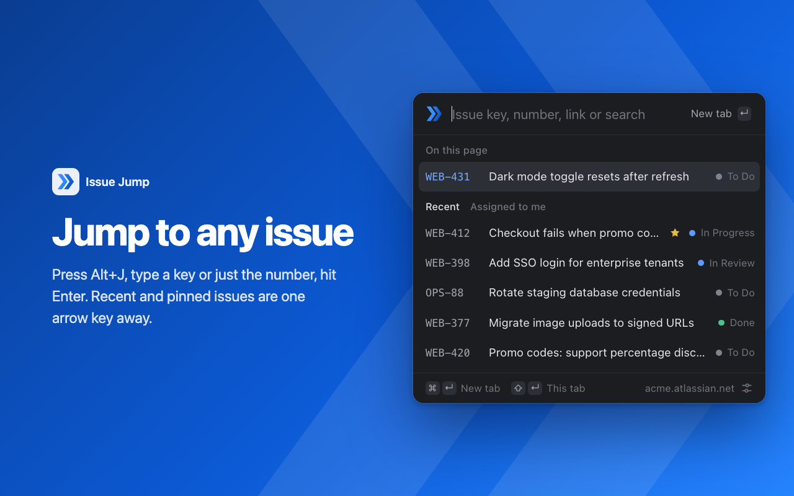

# Issue Jump

[](https://github.com/rejochandran/issue-jump/actions/workflows/ci.yml)
[](https://github.com/rejochandran/issue-jump/releases/latest)
[](LICENSE)

A Chrome extension that opens any Jira issue in one keystroke. Press `Alt+J`, type `123`, hit Enter.



## What it does

- **Understands whatever you paste.** `ABC-123`, `abc123`, `abc 123`, just `123`, a Jira link, a branch name, or several keys at once.
- **Opens in the right place.** A new tab normally, the current tab when it is blank. Hold `⌘`/`Ctrl` or `Shift` to choose.
- **Shows the issue before you open it.** Summary and status appear as you type.
- **Searches when you don't know the key.** Type a few words to search issue titles and projects, or jump to a full Jira search.
- **Knows what you're looking at.** Issue keys in the current page's title or address (a pull request, a branch, a doc) are offered first.
- **Keeps your recent and pinned issues**, plus a list of open issues assigned to you.
- **Works from the address bar** (`j`, space, then a key) and from the right-click menu on selected text.
- **Sets itself up.** If Jira is open in a tab, it finds your site on its own.

It works with Jira Cloud out of the box and with Jira Server / Data Center after you allow access to your site. Support for GitHub, GitLab, Linear and other trackers is planned.

## Install

**Chrome Web Store:** coming soon.

**From a release:**

1. Download `issue-jump-x.y.z.zip` from the [latest release](https://github.com/rejochandran/issue-jump/releases/latest) and unzip it.
2. Open `chrome://extensions` and turn on **Developer mode**.
3. Click **Load unpacked** and choose the unzipped folder.

**From source:** clone the repository and load the `extension/` folder the same way.

## Using it

| You type | Issue Jump opens |
|---|---|
| `ABC-123`, `abc123`, `abc 123` | ABC-123 |
| `123` | ABC-123, once ABC is your default project |
| a link or branch name containing a key | that issue |
| `ABC-1, ABC-2, OPS-3` | all three, the first one focused |
| `checkout bug` | matching issues and projects, or a Jira search |

| Key | Action |
|---|---|
| `Alt+J` | Open the popup (change it at `chrome://extensions/shortcuts`) |
| `↑` `↓` | Move through the list |
| `Enter` | Open the selected row |
| `⌘`/`Ctrl` + `Enter` | Open in a new tab |
| `Shift` + `Enter` | Open in the current tab |
| `⌘`/`Ctrl` + `C` | Copy the selected row's link |
| `Tab` (empty box) | Switch between Recent and Assigned to me |
| `⌘`/`Ctrl` + `,` | Settings |

The default project is learned from the first issue you open, and can be changed in settings.

## Privacy

Issue Jump has no server, no analytics and no account. Your settings and recent issues stay in your browser. Previews and search talk only to your own Jira site, using the login you already have. See [PRIVACY.md](PRIVACY.md).

| Permission | Why |
|---|---|
| `tabs` | See whether the current tab is blank, read its title for issue keys, and find your Jira site on first run |
| `storage` | Save settings and recent issues |
| `contextMenus` | The right-click "Open in Jira" item |
| `*.atlassian.net` | Previews and search on Jira Cloud |
| `clipboardRead` (optional) | Only if you turn on "Paste from clipboard" |
| Other sites (optional) | Only your own Jira Server / Data Center address, when you add it |

## Development

No build step and no dependencies. You need Node 20 or newer for the tooling.

```bash
npm test          # unit tests
npm run check     # manifest, version and store-policy checks
npm run preview   # the popup in a normal browser tab, with fake data
npm run build     # dist/issue-jump-<version>.zip
```

```
extension/        the extension itself; this folder is what ships
  lib/jira.js     parsing, URLs, storage and Jira REST calls
  popup.*         the popup
  background.js   address bar, right-click menu
tests/            unit tests for lib/jira.js
tools/preview/    browser preview with a fake chrome API
scripts/          check, build and icon rendering
store/            Chrome Web Store listing text and images
```

See [CONTRIBUTING.md](CONTRIBUTING.md) to get involved and [docs/releasing.md](docs/releasing.md) for how releases reach the store.

## Support the project

Issue Jump is free and will stay free. If it saves you time, you can help by starring the repository, [reporting bugs](https://github.com/rejochandran/issue-jump/issues/new/choose), or [sponsoring its development](https://github.com/sponsors/rejochandran).

## License

[MIT](LICENSE)

Issue Jump is an independent project. It is not affiliated with, endorsed by or sponsored by Atlassian. Jira is a trademark of Atlassian.
