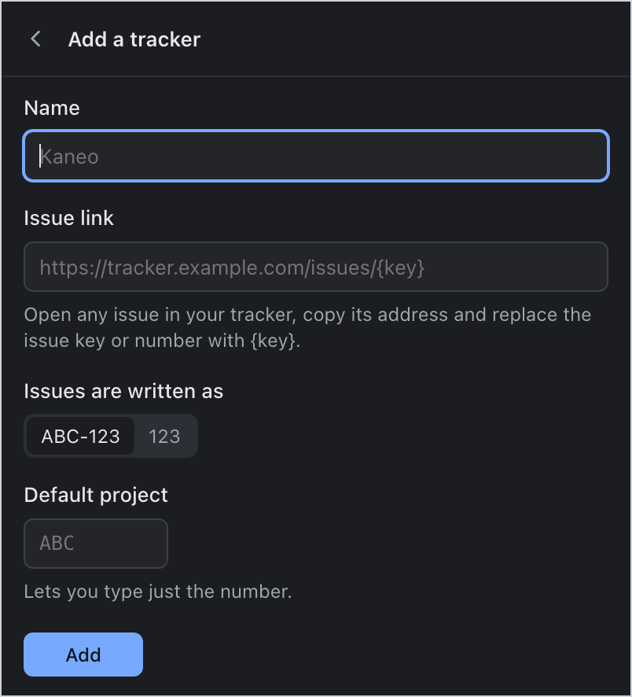

# Custom trackers

Any tracker that gives each issue its own address can be used: Kaneo, Plane, YouTrack, Redmine, Bugzilla, an in-house tool.

| | |
|---|---|
| Jump | ✓ |
| Previews and search | Not available |
| Assigned to me | Not available |
| Needs | A link pattern |



## Setup

1. Open any issue in your tracker and copy its address, for example:

   ```
   https://kaneo.yourcompany.com/dashboard/task/482
   ```

2. **Settings → Add a tracker → Custom**.
3. Give it a **Name**, such as `Kaneo`.
4. In **Issue link**, paste the address and replace the issue's key or number with `{key}`:

   ```
   https://kaneo.yourcompany.com/dashboard/task/{key}
   ```

5. Under **Issues are written as**, choose:
   - **ABC-123** if issues have a project prefix. You can then set a **Default project** so a bare number works.
   - **123** if issues are plain numbers.
6. Click **Add**.

## What you type

- With **123**: type `482`.
- With **ABC-123**: type `OPS-12`, or just `12` if `OPS` is the default project.
- Paste a link that matches your pattern and it is recognised as that issue.

## Good to know

- You can add as many custom trackers as you need.
- If you chose **123** and also have other trackers, set **Settings → Bare numbers go to** to the one you use most.
- A custom tracker makes no network requests. Rows show the key without a title.
- With **[[browser history|Settings]]** turned on, issues you visit in a custom tracker appear in Recent with their page titles.

## Want previews for your tracker?

[Request it in Ideas](https://github.com/rejochandran/issue-jump/discussions/new?category=ideas). Include what an issue link looks like and a link to the tracker's API documentation.
