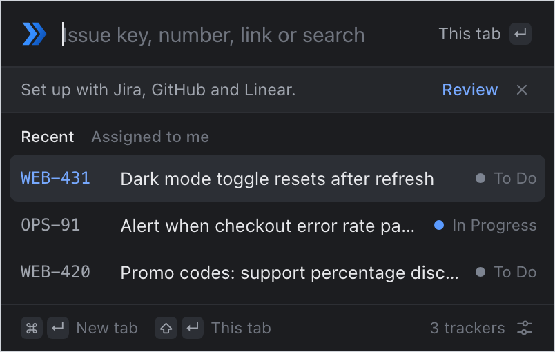
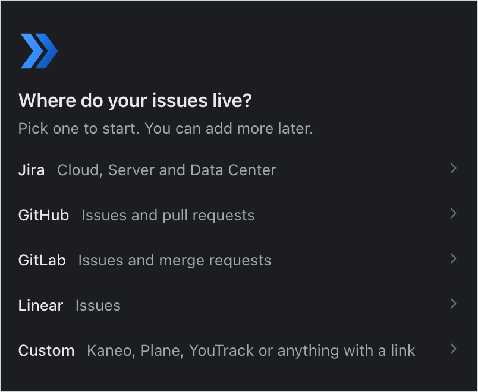
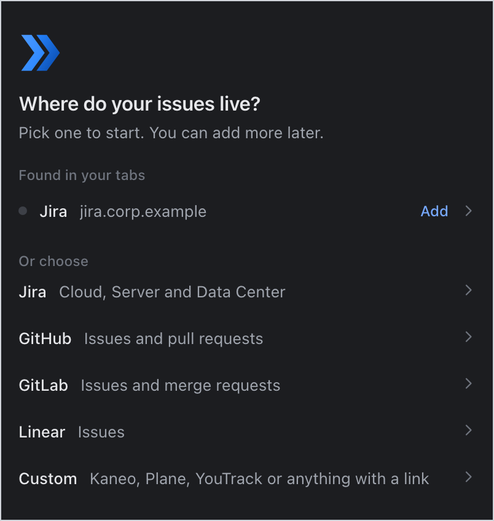

# Getting started

## Install

**From a release**

1. Open the [latest release](https://github.com/rejochandran/issue-jump/releases/latest).
2. Under **Assets**, download `issue-jump-x.y.z.zip`. Do not use "Source code"; Chrome cannot load that one directly.
3. Unzip it.
4. Open `chrome://extensions` and turn on **Developer mode** (top right).
5. Click **Load unpacked** and choose the unzipped folder.
6. Click the puzzle-piece icon in the toolbar and pin **Issue Jump**.

It works the same way in other Chromium browsers such as Edge, Brave and Arc.

## First run

Open the popup with `Alt+J` or by clicking the icon.

**If you have a tracker open in a tab**, Issue Jump recognises it and sets it up without asking. This happens for `github.com`, `gitlab.com`, `linear.app` and a single Jira Cloud site (`yourcompany.atlassian.net`). A strip at the top tells you what it found; **Review** takes you to settings.

**If nothing is open**, you are asked where your issues live. Pick a tracker and fill in its short form.

**If something looks like a tracker but can't be confirmed**, such as Jira on your company's own server, it is offered at the top for you to add with one click. Issue Jump never adds a self-hosted address on its own.

## Turning on previews

Jumping to an issue works straight away. Titles, statuses and search need access to the tracker:

- **Jira Cloud** works immediately if you are signed in to Jira in this browser.
- **GitHub and GitLab** show a **Turn on previews** strip. Click **Allow** and approve Chrome's prompt once.
- **Linear** needs an API key. See [[Linear]].

## The keyboard shortcut

`Alt+J` opens the popup. To change it, go to **Settings → Keyboard shortcut → Change**, or open `chrome://extensions/shortcuts`.

If `Alt+J` does nothing, another extension may already use it. Set a different one on that page.

## Next

- [[Using the popup]]
- [[Trackers]]
