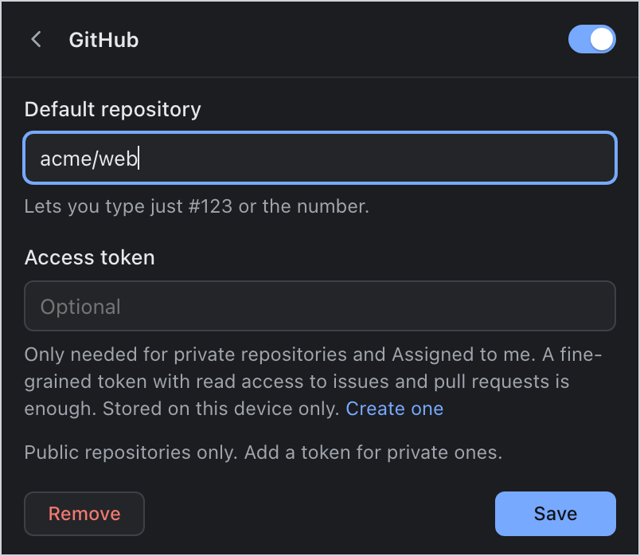

# GitHub

Issues and pull requests on github.com.

| | |
|---|---|
| Jump | ✓ |
| Previews and search | ✓ for public repositories; private ones need a token |
| Assigned to me | With a token |
| Needs | Nothing for public repositories |

## Setup

If a GitHub repository is open in a tab on first run, GitHub is added with that repository as the default. Otherwise:

1. **Settings → Add a tracker → GitHub**.
2. In **Default repository**, type `owner/name`, or paste a link to the repository.
3. Click **Add** and approve Chrome's prompt for `api.github.com`.

## What you type

| You type | Opens |
|---|---|
| `owner/repo#45` | Issue or pull request 45 in that repository |
| `#45` or `45` | Number 45 in your default repository |
| A GitHub issue or pull request link | That one |

Bare numbers go to GitHub only if it is chosen under **Settings → Bare numbers go to**, or if it is your only tracker.

## Adding a token

You need a token only for private repositories and for **Assigned to me**.

1. On the GitHub tracker page, click **Create one** under **Access token**. This opens GitHub's token page.
2. Create a **fine-grained token**. Choose the repositories it may see and give it **read-only** access to **Issues** and **Pull requests**.
3. Copy the token, paste it into **Access token** and click **Save**.

The token is stored on this device only. It is never synced to your other browsers and is sent only to `api.github.com`.

## Good to know

- Without a token GitHub allows a limited number of lookups per hour. If previews stop for a while, that limit was reached; jumping keeps working.
- Search looks in issue and pull request titles in your default repository.
