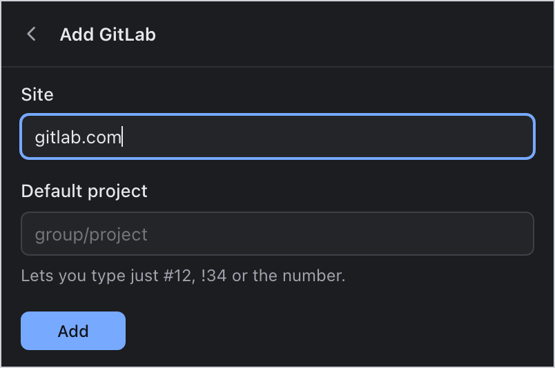

# GitLab

Issues and merge requests on gitlab.com or your own GitLab server.

| | |
|---|---|
| Jump | ✓ |
| Previews and search | ✓ |
| Assigned to me | ✓ |
| Needs | Being signed in to GitLab in this browser |

## Setup

If a gitlab.com project is open in a tab on first run, GitLab is added with that project as the default. Otherwise:

1. **Settings → Add a tracker → GitLab**.
2. **Site** is `gitlab.com` unless you run your own server; then enter its address.
3. In **Default project**, type `group/project`, or paste a link to the project. Subgroups work: `group/subgroup/project`.
4. Click **Add** and approve Chrome's prompt for that site.

## What you type

| You type | Opens |
|---|---|
| `group/project#12` | Issue 12 in that project |
| `group/project!34` | Merge request 34 in that project |
| `#12` or `12` | Issue 12 in your default project |
| `!34` | Merge request 34 in your default project |
| A GitLab issue or merge request link | That one |

`!34` always goes to GitLab, even when bare numbers are set to go to another tracker.

## Good to know

- Search looks in the issues of your default project.
- **Assigned to me** lists your open issues across all projects.
- If previews don't appear, check that you are signed in to GitLab in this browser.
