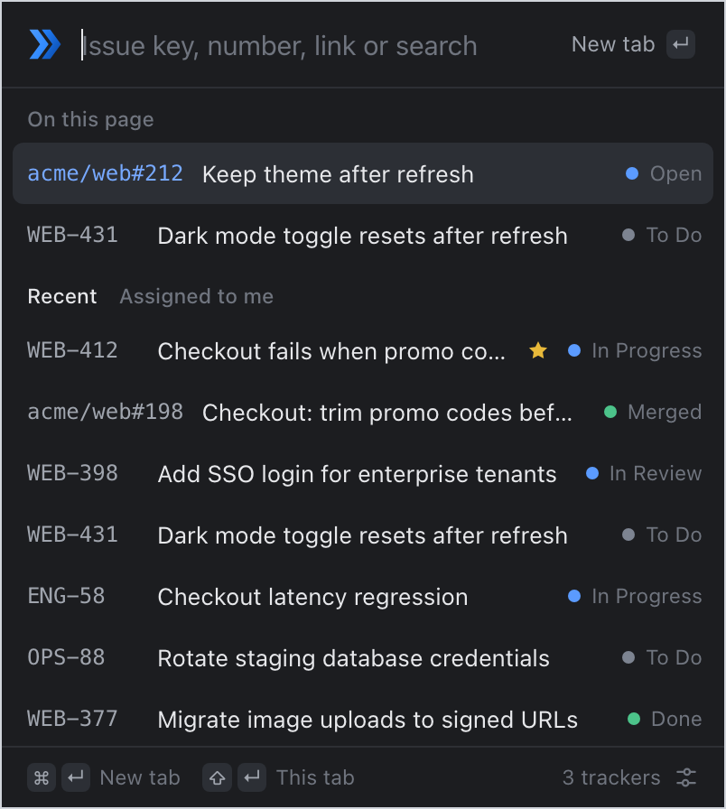

# Issue Jump

Issue Jump is a Chrome extension that takes you to any issue in one keystroke. Press `Alt+J`, type `123`, press Enter.

It works with **Jira**, **GitHub**, **GitLab** and **Linear**, and with any other tracker you can give a link pattern for.

## Start here

1. **[[Install it|Getting started]]** and open the popup. Trackers you have open in a tab are set up for you.
2. **[[Learn what you can type|Using the popup]]**: keys, numbers, links, several at once, or a few words to search.
3. **[[Connect more trackers|Trackers]]** if you use more than one.

## All pages

**Using it**
- [[Getting started]]: installing, first run, the keyboard shortcut
- [[Using the popup]]: what you can type, keyboard keys, recent, pinned and assigned issues
- [[Address bar and right-click menu|Address bar and right click menu]]: jumping without opening the popup

**Trackers**
- [[Trackers]]: what each one supports and what it needs
- [[Jira]], [[GitHub]], [[GitLab]], [[Linear]], [[Custom trackers]]: setting up each one

**Reference**
- [[Settings]]: every setting explained
- [[Privacy and permissions]]: what is stored, what is sent, and why each permission exists
- [[Troubleshooting]]: fixes for the common problems

## Get help or ask for something

- **Something not working?** Check [[Troubleshooting]], then [report a bug](https://github.com/rejochandran/issue-jump/issues/new?template=bug.yml).
- **Have an idea, or want another tracker?** [Post it in Ideas](https://github.com/rejochandran/issue-jump/discussions/new?category=ideas) or [upvote existing ones](https://github.com/rejochandran/issue-jump/discussions/categories/ideas?discussions_q=category%3AIdeas+sort%3Atop).
- **Have a question?** [Ask in Q&A](https://github.com/rejochandran/issue-jump/discussions/new?category=q-a).
