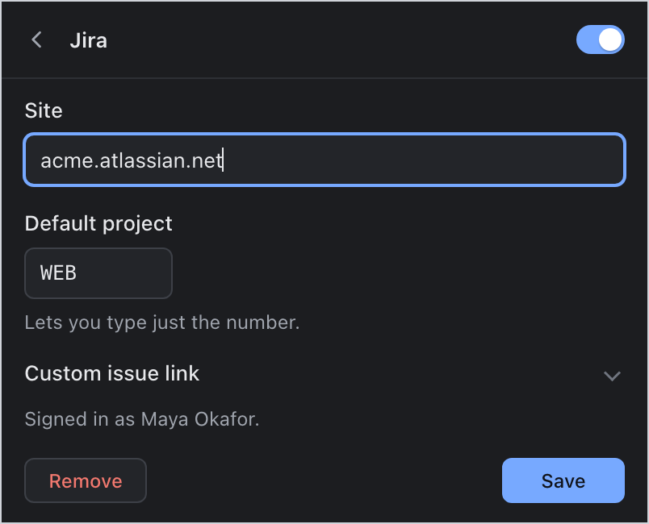

# Jira

Works with Jira Cloud, Jira Server and Jira Data Center.

| | |
|---|---|
| Jump | ✓ |
| Previews and search | ✓ |
| Assigned to me | ✓ |
| Recently viewed in Jira | ✓ added to Recent automatically |
| Needs | Being signed in to Jira in this browser |



## Jira Cloud

If Jira is open in a tab when you first use Issue Jump, there is nothing to do. Otherwise:

1. **Settings → Add a tracker → Jira**.
2. In **Site**, type your address, for example `yourcompany.atlassian.net`. Just `yourcompany` works too, and so does pasting any link from your Jira.
3. Click **Add**.

## Jira Server and Data Center

Same steps, with your server's address in **Site**, for example `jira.yourcompany.com`. When you click **Add**, Chrome asks for permission to access that one site. Approve it to get previews and search; jumping works either way.

## Default project

With a default project of `WEB`, typing `123` opens WEB-123.

It is usually filled in for you, from the Jira page you had open or from the issues you viewed recently. You can change it on the tracker's page. Keys from other projects still work when typed in full.

## Custom issue link

By default issues open at `https://your-site/browse/KEY`. If your team uses a different address, open **Custom issue link** and enter it with `{key}` where the key goes, for example:

```
https://yourcompany.atlassian.net/jira/browse/{key}/
```

## What you type

`WEB-123`, `web123`, `web 123`, `123` (with a default project), or any Jira link, including board links with a selected issue.

## Problems

- **"Sign in to Jira to see previews and search"**: you are signed out. Click **Sign in**, log in, and reopen the popup.
- **No previews on a self-hosted site**: open the tracker's page and click **Save** to get Chrome's permission prompt again.

More in [[Troubleshooting]].
