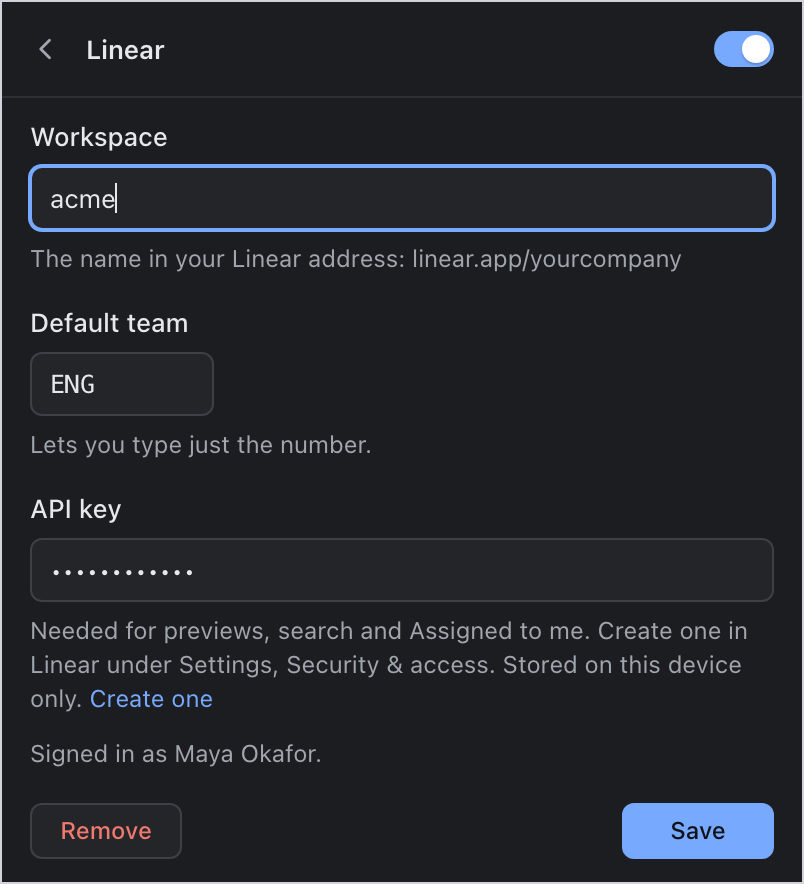

# Linear

| | |
|---|---|
| Jump | ✓ |
| Previews and search | With an API key |
| Assigned to me | With an API key |
| Needs | An API key for anything beyond jumping |

## Setup

If Linear is open in a tab on first run, it is added with your workspace filled in. Otherwise:

1. **Settings → Add a tracker → Linear**.
2. In **Workspace**, type the name from your Linear address. For `linear.app/yourcompany` that is `yourcompany`.
3. Optionally set a **Default team**, such as `ENG`, so that typing `123` opens ENG-123.
4. Click **Add**.

Jumping works now: type `ENG-123` and press Enter.

## Adding an API key

Linear does not let extensions use your browser login, so previews, search and **Assigned to me** need a personal API key.

1. On the Linear tracker page, click **Create one** under **API key**. This opens Linear's security settings.
2. Create a **personal API key**. Read access is enough.
3. Copy the key, paste it into **API key** and click **Save**. Approve Chrome's prompt for `api.linear.app`.

The key is stored on this device only. It is never synced to your other browsers and is sent only to `api.linear.app`.

## What you type

`ENG-123`, `eng123`, `eng 123`, `123` (with a default team), or any Linear issue link.

## Good to know

- If you also use Jira, both use keys like `ENG-123`. Issue Jump works out which tracker a project belongs to the first time you open one of its issues. See [[Using the popup]].
- **"Linear didn't accept the saved key"** means the key was revoked or mistyped. Click **Fix** and paste a new one.
