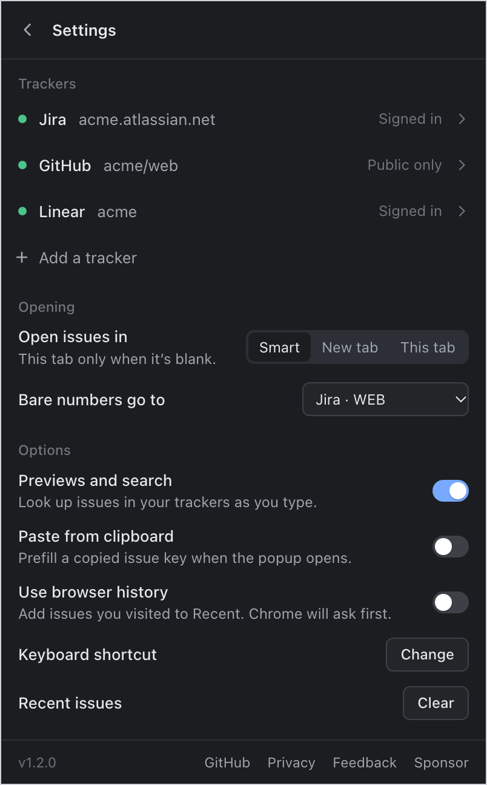
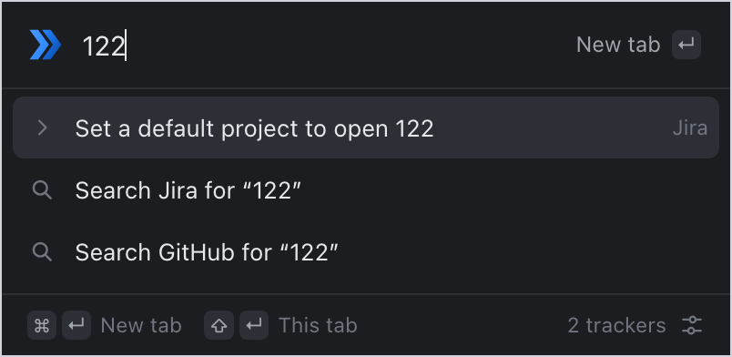

# Settings

Open settings with the button at the bottom right of the popup, or `⌘`/`Ctrl` + `,`.

## Trackers

One row per tracker, showing where it points and its state. Click a row to change it. See [[Trackers]].

| State | Meaning |
|---|---|
| Signed in | Previews, search and Assigned to me work |
| Public only | GitHub without a token: public repositories only |
| Links only | Jumping works; this tracker has no previews, or previews are off |
| Allow access | Click the row and **Save** to get Chrome's permission prompt |
| Sign in | You are signed out of the tracker in this browser |
| Add API key | Linear needs a key for previews |
| Off | The tracker is switched off |

## Opening

**Open issues in**

| Choice | What Enter does |
|---|---|
| Smart | Opens a new tab, unless the current tab is blank; then it uses that one |
| New tab | Always opens a new tab |
| This tab | Always replaces the current tab |

Whatever you choose, `⌘`/`Ctrl` + `Enter` forces a new tab and `Shift` + `Enter` forces the current one.

**Bare numbers go to** appears when you have more than one tracker. It decides where `123` goes.

If a number does nothing because the tracker has no default project yet, the popup says so and Enter takes you to the setting.

## Options

**Previews and search** looks up titles, statuses and search results as you type. Turn it off and Issue Jump makes no network requests at all; it only opens links.

**Paste from clipboard** fills the box with an issue key you have copied, so you can open the popup and press Enter. Chrome asks for clipboard permission when you turn it on. A bare number on the clipboard is ignored.

**Use browser history** adds issues you visited in your connected trackers to Recent, including custom trackers. Chrome asks for history permission when you turn it on. Only addresses on your trackers from the last 30 days are looked at, and only issue pages are kept. See [[Privacy and permissions]].

**Keyboard shortcut** opens Chrome's shortcut page, where you can change `Alt+J`.

**Recent issues → Clear** empties Recent but keeps pinned issues. After clearing, only issues you open or view from then on are added.

## Where settings are kept

Settings follow you to other browsers where you are signed in to Chrome. Recent issues and API keys stay on this device.
