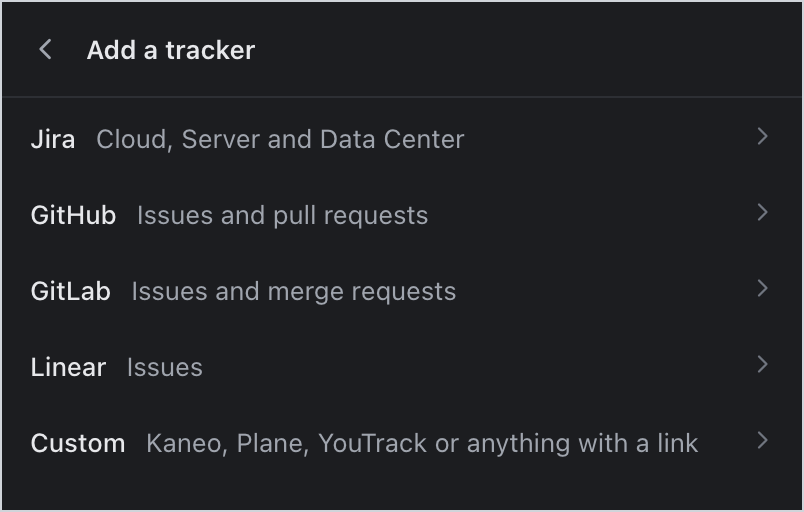

# Trackers

Issue Jump can use several trackers at once. Each has its own page with setup steps.

| Tracker | Jump | Previews and search | Assigned to me | What it needs |
|---|---|---|---|---|
| [[Jira]] (Cloud, Server, Data Center) | ✓ | ✓ | ✓ | Being signed in to Jira |
| [[GitHub]] issues and pull requests | ✓ | ✓ public repositories | with a token | A token only for private repositories |
| [[GitLab]] issues and merge requests | ✓ | ✓ | ✓ | Being signed in to GitLab |
| [[Linear]] | ✓ | with an API key | with an API key | An API key for anything beyond jumping |
| [[Custom trackers]] (Kaneo, Plane, YouTrack, Redmine, ...) | ✓ | | | A link pattern |

## Adding a tracker

Trackers open in your tabs are added automatically on first run, and offered with an **Add** button when a new one shows up later.

To add one by hand: **Settings → Add a tracker**, pick the type, fill in the form.

## Changing or removing a tracker

In **Settings**, click the tracker's row.

- The switch at the top right turns it off without deleting it.
- **Remove** deletes it, along with any API key saved for it.

Each row shows the tracker's state. If something is left to do, the row says what: **Allow access**, **Sign in**, **Add API key**.

## Using more than one

- **Keys** such as `WEB-123` go to whichever of Jira or Linear owns that project. Issue Jump learns this the first time you open an issue from a project.
- **`owner/repo#45`** goes to GitHub, **`group/project!67`** to GitLab.
- **Bare numbers** go to one tracker, chosen under **Settings → Bare numbers go to**.
- **Search** and **Assigned to me** cover all of them.

## Want another tracker built in?

[Post it in Ideas](https://github.com/rejochandran/issue-jump/discussions/new?category=ideas), or write it yourself: a tracker is one small file, described in [docs/providers.md](https://github.com/rejochandran/issue-jump/blob/dev/docs/providers.md). In the meantime it will work as a [[custom tracker|Custom trackers]].
