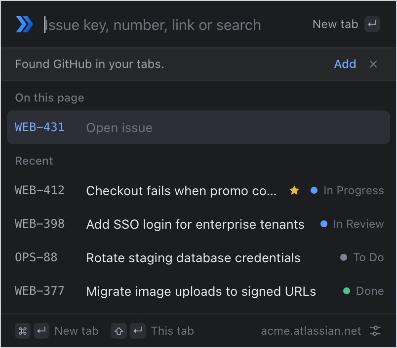

# Troubleshooting

## Installing

**"Manifest file is missing or unreadable"**
You loaded GitHub's "Source code" zip. Download `issue-jump-x.y.z.zip` from the release's **Assets** instead. If you want to use the source, load the `extension` folder inside it.

**The icon isn't in the toolbar**
Click the puzzle-piece icon and pin Issue Jump.

**`Alt+J` does nothing**
Another extension may use it. Set a different shortcut at `chrome://extensions/shortcuts`.

## Jumping

**Typing a number only offers a search**
The tracker that numbers go to has no default project or repository. The first row offers to set it; press Enter. Or open **Settings**, click the tracker and fill it in. See [[Settings]].

**A number goes to the wrong tracker**
Change **Settings → Bare numbers go to**.

**A key opens in the wrong tracker**
Jira and Linear share the `ABC-123` format. Open the tracker's page in settings and set its default project or team, or type the key once and pick the right row; the choice is remembered.

**The issue opens at the wrong address**
For Jira, set **Custom issue link** on the tracker's page. For a custom tracker, check the pattern has `{key}` exactly where the key belongs. See [[Jira]] and [[Custom trackers]].

**It replaced the page I was on**
With **Open issues in → Smart**, a blank tab is reused. If it replaced a real page, check the setting isn't **This tab**, and that you didn't hold `Shift`.

## Previews and search

**No titles or statuses appear**
- Check **Settings → Previews and search** is on.
- Look at the tracker's row in settings. It names what is missing: **Allow access**, **Sign in** or **Add API key**.
- Custom trackers never show previews.

**"Sign in to … to see previews and search"**
You are signed out of that tracker in this browser. Click **Sign in**, log in, reopen the popup.

**"Turn on previews for …"**
Click **Allow** and approve Chrome's prompt. If you declined before, click it again.

**"… didn't accept the saved key"**
The token or API key was revoked, expired or mistyped. Click **Fix** and paste a new one.

**"Not found, or you don't have access"**
The issue doesn't exist, or your account can't see it. For a private GitHub repository, add a token. See [[GitHub]].

**GitHub previews stopped working for a while**
Without a token GitHub limits lookups per hour. Wait, or add a token.

**"Assigned to me" is missing**
It appears only when a tracker can provide it: Jira or GitLab while signed in, GitHub with a token, Linear with an API key.

## Recent issues

**An issue I removed came back**
It returns only if you open it again through Issue Jump. If it comes back otherwise, please [report it](https://github.com/rejochandran/issue-jump/issues/new?template=bug.yml).

**Recent has issues I never opened here**
Issues you view in Jira directly are included, and so are visited issues if **Use browser history** is on. Turn that off in [[Settings]] if you don't want it.

## Trackers

**My tracker wasn't found automatically**
Only `github.com`, `gitlab.com`, `linear.app` and a single Jira Cloud site are added without asking. Self-hosted trackers, and Jira when two different Jira Cloud sites are open, must be added or confirmed by you: **Settings → Add a tracker**.

**"That tracker is already added"**
There is already a tracker with the same address. Edit that one instead.

## Still stuck?

1. Right-click the popup, choose **Inspect**, and look at the **Console** tab for errors.
2. [Ask in Q&A](https://github.com/rejochandran/issue-jump/discussions/new?category=q-a) or [report a bug](https://github.com/rejochandran/issue-jump/issues/new?template=bug.yml). Include your Issue Jump version (bottom of Settings), browser and tracker.
