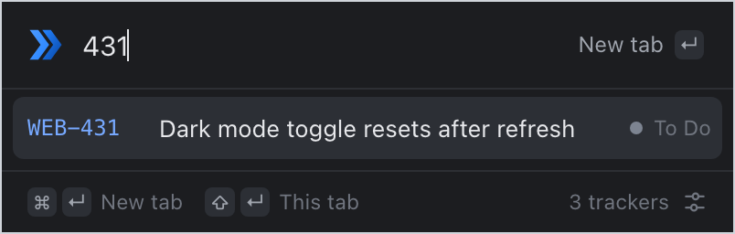
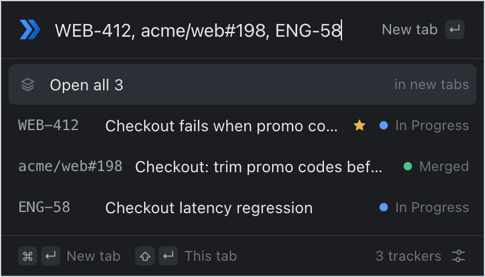
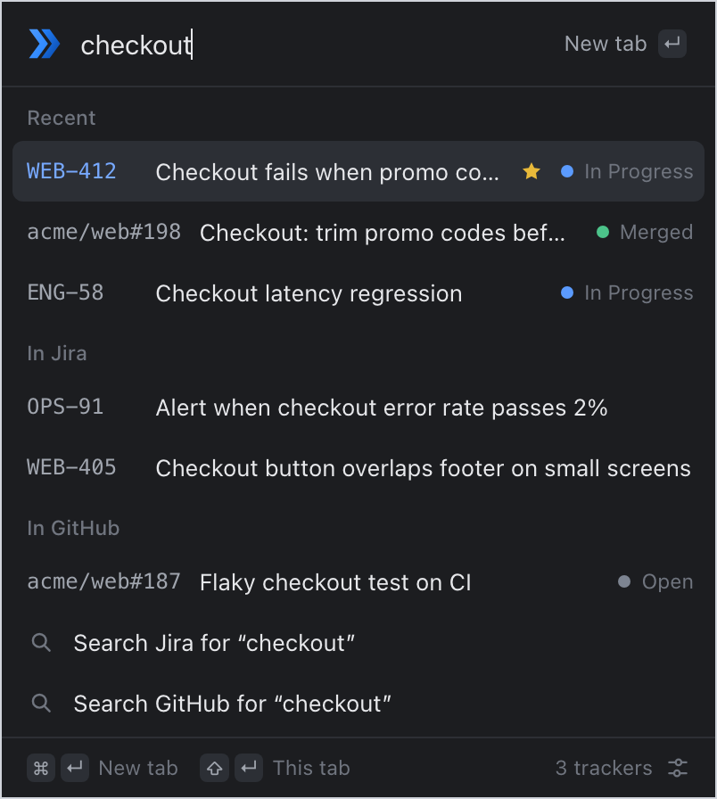
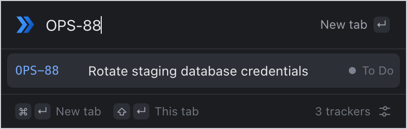
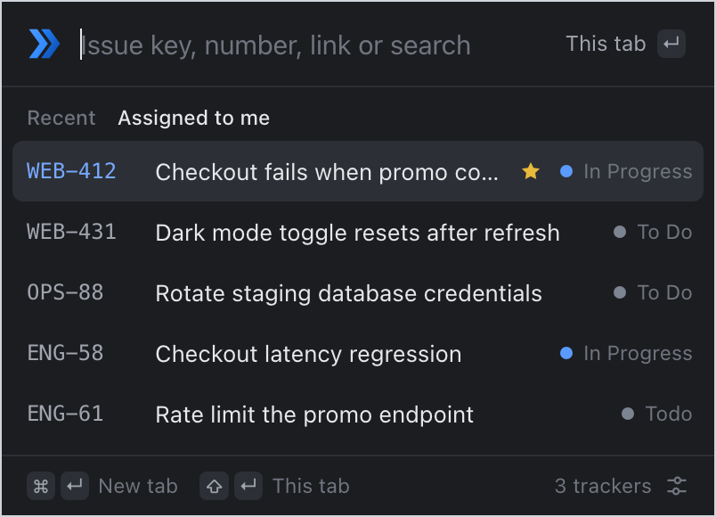

# Using the popup

The popup is one box and one list. Type, use the arrow keys, press Enter.

## What you can type

| You type | What opens |
|---|---|
| `WEB-123`, `web123`, `web 123` | Issue WEB-123 in Jira or Linear |
| `123` or `#123` | Issue 123 in your default project or repository |
| `acme/web#45` | That GitHub issue or pull request |
| `acme/api!67`, or `!67` | That GitLab merge request |
| A link from any connected tracker | That issue |
| A branch name such as `feature/WEB-9-fix-login` | WEB-9 |
| `WEB-1, WEB-2, #45` | All of them, side by side |
| `checkout bug` | Matching issues from every tracker |

Upper or lower case does not matter.

### Previews

When previews are on, the issue's title and status appear as you type, before you open it.

### Several at once

Paste a list separated by commas or spaces. **Open all** opens every one: the first in front, the rest in background tabs. Each goes to the tracker it belongs to.

### Searching

Type a few words. Results come from your recent issues first, then from each connected tracker. The last rows open the tracker's own search page.

### When a key could belong to two trackers

Jira and Linear both use keys like `OPS-88`. The first time you type a key from a project Issue Jump hasn't seen, it checks both trackers and shows where it found the issue. Once you open it, that project is remembered and goes straight to the right place.

## Where it opens

| | Opens in |
|---|---|
| `Enter` | A new tab, or the current tab if it is blank |
| `⌘`/`Ctrl` + `Enter` | Always a new tab |
| `Shift` + `Enter` | Always the current tab |

The label at the right of the box shows where Enter will open, and changes while you hold a key. To change the default, see [[Settings]].

## Keyboard

| Key | Action |
|---|---|
| `Alt+J` | Open the popup |
| `↑` `↓` | Move through the list |
| `Enter` | Open the selected row |
| `⌘`/`Ctrl` + `C` | Copy the selected row's link (when no text is selected in the box) |
| `Tab` (empty box) | Switch between Recent and Assigned to me |
| `Esc` | Clear the box, or close the popup |
| `⌘`/`Ctrl` + `,` | Settings |

## The lists

**On this page** appears when the tab you are on mentions an issue, in its address or its title. On a pull request titled "WEB-431: keep theme", both the pull request and WEB-431 are offered.

**Recent** holds the last 30 issues you opened or viewed. It includes issues you viewed in Jira directly, and, if you turn on [[browser history|Settings]], issues you visited in any tracker.

**Assigned to me** lists your open issues across trackers. Click the heading or press `Tab` in an empty box.

## Pin, copy, remove

Point at a row to see three buttons:

- **Star** pins the issue to the top of Recent. Pinned issues are never pushed out.
- **Copy** copies its link.
- **×** removes it from Recent. It stays out until you open it again.

## Next

- [[Address bar and right-click menu|Address bar and right click menu]]
- [[Settings]]
